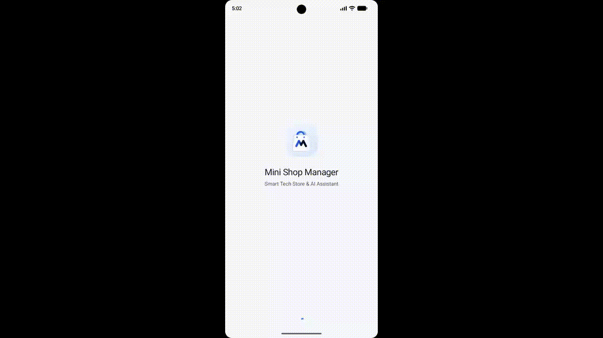
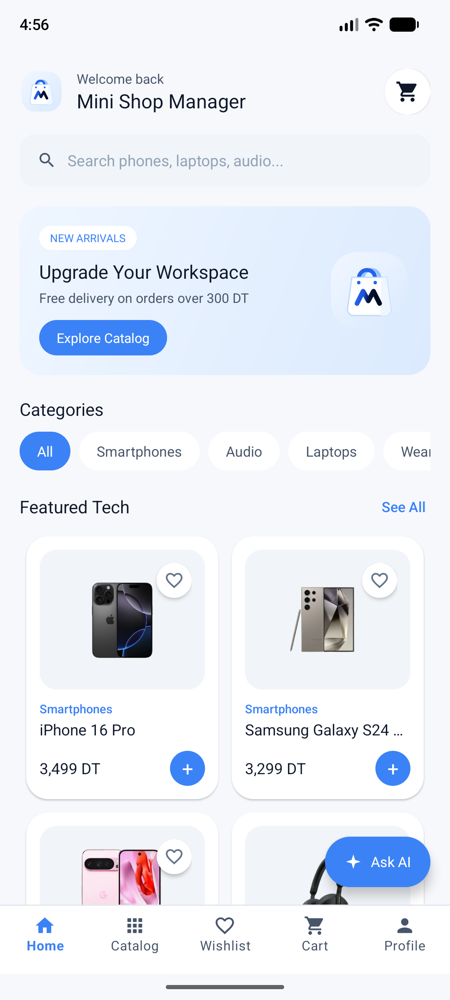
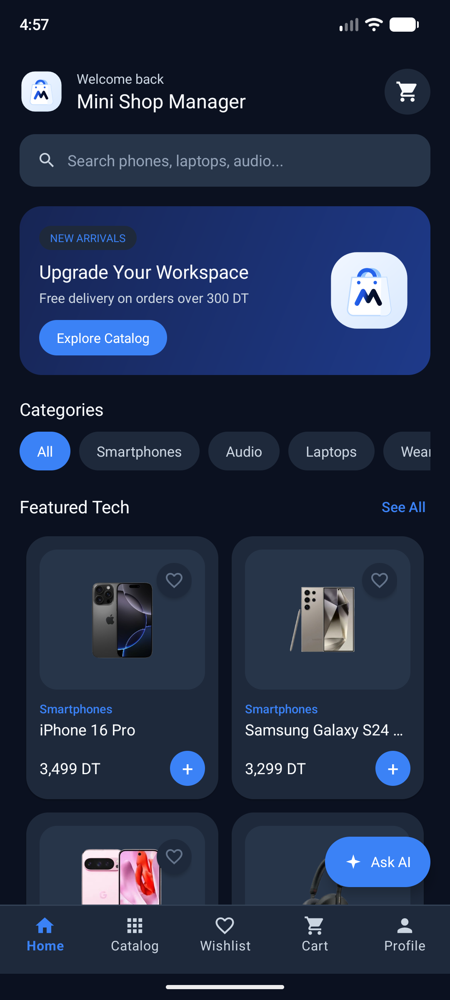
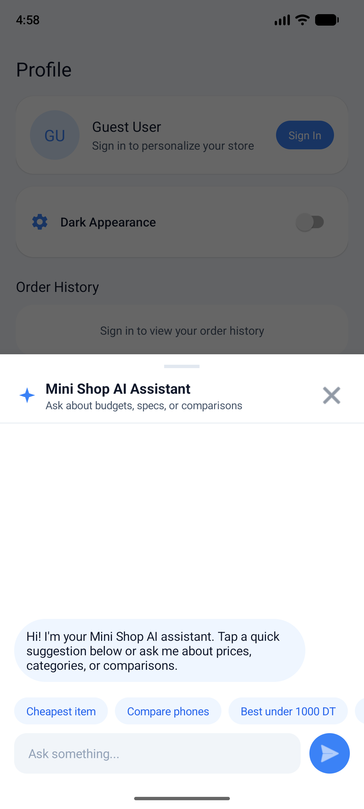
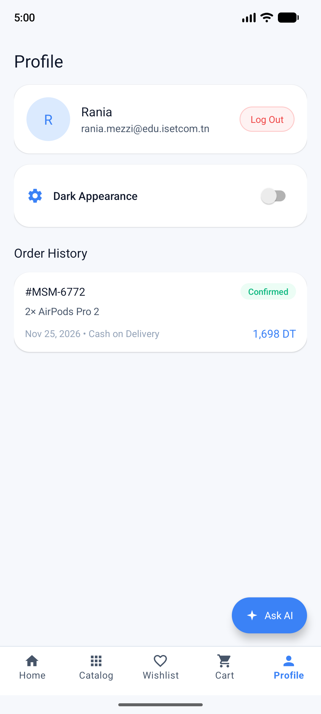

<div align="center">

  

  # 🛍️ Mini Shop Manager
  **An Offline-First Android Electronics Storefront with an Actionable AI Shopping Copilot**

  <p>
    
    
    
    
    
    <a href="LICENSE"></a>
  </p>

  <p>
    <a href="#-key-features">Features</a> •
    <a href="#-interactive-ai-copilot">AI Copilot</a> •
    <a href="#-architecture--data-flow">Architecture</a> •
    <a href="#-screen-by-screen-guide">Screens</a> •
    <a href="#-database--storage-schema">Storage</a> •
    <a href="#-screenshots">Screenshots</a> •
    <a href="#-installation--setup">Setup</a>
  </p>

  <p>
    <i>Browse flagship tech, compare hardware specs through an offline AI assistant, switch seamlessly between Light and Dark themes, and complete orders end-to-end—without external backend dependencies.</i>
  </p>

  

</div>

---

## 📖 Overview

**Mini Shop Manager** is a full-featured native Android e-commerce application engineered in **Kotlin** for consumer electronics retail. Rather than relying on external REST APIs or cloud databases, the product catalog, wishlist, shopping cart, authentication state, and order history operate locally for instant offline responsiveness.

Designed around realistic mobile commerce workflows, it combines **smart catalog discovery**, **actionable conversational AI**, **guest-to-member checkout protection**, and an **adaptive slate-navy Dark Mode**.

---

## ✨ Key Features

### 🤖 Actionable AI Shopping Copilot
- **Natural Language & Quick-Tap Prompts:** Handles queries around budgets (*"Best under 1000 DT"*), price extremes (*"Cheapest item"*, *"Most expensive"*), categories (*"Show me laptops"*), battery longevity (*"Best battery life"*), and side-by-side comparisons (*"Compare phones"*).
- **Embedded Product Action Cards:** Bot replies dynamically render interactive product cards directly inside the chat stream—allowing users to tap a product to inspect full specs or tap **`+ Cart`** to add it to SQLite and update the navigation cart badge live.

### 🛍️ Storefront, Search & Dual-Mode Catalog
- **Curated Home Experience:** Features a personalized welcome header, live search bar, promotional hero banner (*Free delivery on orders over 300 DT*), horizontal category filter pills (*All, Smartphones, Audio, Laptops, Wearables, Accessories*), and a featured tech grid.
- **Grid & List View Switching:** Toggle dynamically between a compact **2-column Grid** and a detailed **List View** inside `CatalogFragment` while preserving active search queries and category filters.
- **Rich Product Detail Pages:** Displays product visuals, category tags, Tunisian Dinar (`DT`) formatting, battery endurance metrics, live stock status, and instant Wishlist/Cart actions.

### 🛒 Smart Cart & Protected Checkout
- **Real-Time Cart Calculations:** Increment/decrement item quantities, clear the entire cart, and automatically waive the **7 DT** shipping fee once the subtotal reaches **300 DT**.
- **Frictionless Guest-to-Buyer Flow:** Guest users can browse the catalog, save items to their Wishlist, ask the AI assistant, and build a cart without barriers—sign-in is only required when tapping **Proceed to Checkout**.
- **Validated Checkout & Order Tracking:** Enforces delivery address and phone number validation, supports **Cash on Delivery** and **Credit / e-Dinar Card** selection, and generates unique order receipts (`#MSM-XXXX`) stored in SQLite.

### 🌗 Adaptive Light & Dark Mode + Profile Management
- **Complete Day/Night Design System:** Custom `values` and `values-night` palettes transform screens, cards, search inputs, gradient banners, pills, and system status bars cleanly with high contrast.
- **Persistent Local Accounts:** Saves user credentials across logouts via `SharedPreferences`, generates a dynamic two-letter initials avatar, and displays authenticated order history in the Profile tab.

---

## 🧠 Interactive AI Copilot

```text
User Input ("Best under 1000 DT" / "Compare phones")
       │
       ▼
Intent & Regex Analyzer (Budget Threshold • Category Synonyms • Spec Keywords • Rank)
       │
       ▼
In-Memory Product Filter & Sorter (products.json + In-Stock Filter)
       │
       ▼
Bot Message Bubble + Dynamic Product Cards ──► [ Tap Card ] ──► ProductDetailActivity
                                             └► [ + Cart ]  ──► DBHelper + Live Badge Sync
```

---

## 🏗️ Architecture & Data Flow

**Mini Shop Manager** follows a **Single-Activity Navigation Host** (`MainActivity`) paired with modular Fragments for primary tabs and dedicated Activities for onboarding, authentication, product inspection, and checkout.

```text
App Launch
 ├── SplashActivity ──────────► Applies saved Dark/Light theme via AppCompatDelegate
 ├── OnboardingActivity ──────► First-time feature walkthrough (PrefsHelper flag)
 └── MainActivity ────────────► BottomNavigationView + Live Cart Counter Badge
      ├── HomeFragment ───────► Hero Banner • Categories • Featured Grid • Ask AI FAB
      ├── CatalogFragment ────► Search • Category Filter • Grid/List Toggle
      ├── WishlistFragment ───► Saved Favorites synced with SQLite
      ├── CartFragment ───────► Quantity Controls • 300 DT Free Shipping • Auth Gate
      └── ProfileFragment ────► User Avatar • Dark Mode Switch • Authenticated Orders
           ├── LoginActivity ─────────► Local Registration & Sign-In
           ├── ProductDetailActivity ─► Specs, Battery, Stock & Cart/Wishlist Actions
           └── CheckoutActivity ──────► Address/Phone Validation • Payment • Order Receipt
```

---

## 📱 Screen-by-Screen Guide

| Screen | Class | Core Responsibilities |
| :--- | :--- | :--- |
| **Splash & Onboarding** | `SplashActivity`, `OnboardingActivity` | Restores user theme preference on startup and introduces store capabilities on first launch. |
| **Home Storefront** | `HomeFragment` | Displays promotional banner, quick category chips, featured electronics, and launches `AiAssistantBottomSheet`. |
| **Catalog Explorer** | `CatalogFragment` | Real-time keyword search, category filtering, and live layout switching between Grid and List adapters. |
| **AI Copilot Sheet** | `AiAssistantBottomSheet` | Modal bottom sheet with horizontal prompt chips, regex budget parser, comparison engine, and inline `+ Cart` cards. |
| **Product Details** | `ProductDetailActivity` | Full product breakdown (`PRODUCT_ID` intent), stock status, battery specs, wishlist toggle, and add-to-cart. |
| **Shopping Cart** | `CartFragment` | Line-item quantity management, empty-state handling, automatic delivery fee logic, and login check before checkout. |
| **Checkout** | `CheckoutActivity` | Protected checkout form with delivery validation, payment method selector, confirmation dialog, and SQLite order creation. |
| **Profile & Settings** | `ProfileFragment`, `LoginActivity` | Account sign-in/log-out, credential retention, instant Dark Appearance switch, and personal order history list. |

---

## 🗄️ Database & Storage Schema

The local persistence layer splits responsibilities cleanly across three helpers:

| Layer | Helper Class | Storage Mechanism | Data Stored |
| :--- | :--- | :--- | :--- |
| **Product Catalog** | `JsonHelper.kt` | `assets/products.json` | Product ID, name, category, price (`DT`), description, battery life, stock count, and drawable resource name. |
| **Transactional Data** | `DBHelper.kt` | SQLite (`SQLiteOpenHelper`) | **Cart Table** (`product_id`, `quantity`), **Favorites Table** (`product_id`), and **Orders Table** (`order_number`, `total`, `address`, `payment_method`, `items_summary`, `date`). |
| **Session & Settings** | `PrefsHelper.kt` | `SharedPreferences` | `isLoggedIn` state, saved `userName`, `userEmail`, `userPassword`, `isDarkMode`, and `onboardingCompleted`. |

---

## 📸 Screenshots

| Light Mode Storefront | Dark Mode Storefront | Actionable AI Copilot | Profile & Order History |
| :---: | :---: | :---: | :---: |
|  |  |  |  |

---

## 📂 Project Structure

```text
MiniShopManager/
└── app/src/main/
    ├── assets/
    │   └── products.json                 # Offline electronics catalog dataset
    ├── java/com/example/minishopmanager/
    │   ├── SplashActivity.kt
    │   ├── OnboardingActivity.kt
    │   ├── MainActivity.kt
    │   ├── HomeFragment.kt
    │   ├── CatalogFragment.kt
    │   ├── WishlistFragment.kt
    │   ├── CartFragment.kt
    │   ├── ProfileFragment.kt
    │   ├── LoginActivity.kt
    │   ├── ProductDetailActivity.kt
    │   ├── CheckoutActivity.kt
    │   ├── AiAssistantBottomSheet.kt
    │   ├── Product.kt
    │   ├── DBHelper.kt
    │   ├── JsonHelper.kt
    │   ├── PrefsHelper.kt
    │   ├── ProductAdapter.kt
    │   ├── CartAdapter.kt
    │   └── OrderAdapter.kt
    └── res/
        ├── drawable/                     # Custom shapes, gradients, badges & vector icons
        ├── layout/                       # XML layouts for Activities, Fragments & Cards
        ├── values/                       # Light palette, themes & typography
        └── values-night/                 # Dark Mode slate-navy palette & status bar theme
```

---

## 🚀 Installation & Setup

### Prerequisites
- **Android Studio** Ladybug (2024.2.1) or newer
- **JDK 17**
- **Android SDK** with Minimum API **24** (Android 7.0) and Target API **34+**

### Steps to Run
1. **Clone the repository**
   ```bash
   git clone https://github.com/raniamezzi/MiniShopManager.git
   ```
2. **Open in Android Studio**
   - Click **File → Open** and select the `MiniShopManager` root directory.
3. **Sync Gradle & Run**
   - Wait for Gradle dependencies to finish syncing.
   - Choose an emulator (e.g., *Pixel 7a*) or physical Android device and press **Run (`▶`)**.

---

## 🎬 Recommended Demo Walkthrough

1. **Explore & Search:** Launch the app, browse featured tech on **Home**, and switch to **Catalog** to test live search and Grid/List toggling.
2. **Test the AI Copilot:** Tap **`+ Ask AI`**, select *"Cheapest item"* or type *"Best under 1000 DT"*, and tap **`+ Cart`** directly inside the AI reply card to watch the cart badge increment.
3. **Toggle Dark Mode:** Navigate to **Profile** and flip the **Dark Appearance** switch to see the entire UI adapt immediately.
4. **Guest-to-Member Checkout:** Open **Cart**, verify the automatic free delivery calculation (`≥ 300 DT`), tap **Proceed to Checkout**, sign in, and place an order to see it appear under **Order History**.

---

## 📄 License

Released under the **MIT License**. See [LICENSE](LICENSE) for full details.

<div align="center">
  Built with 💙 and <b>Kotlin</b> • Engineered for fast, offline-first mobile commerce.
</div>
